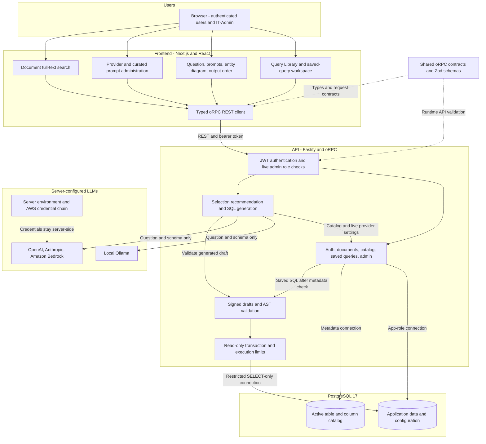
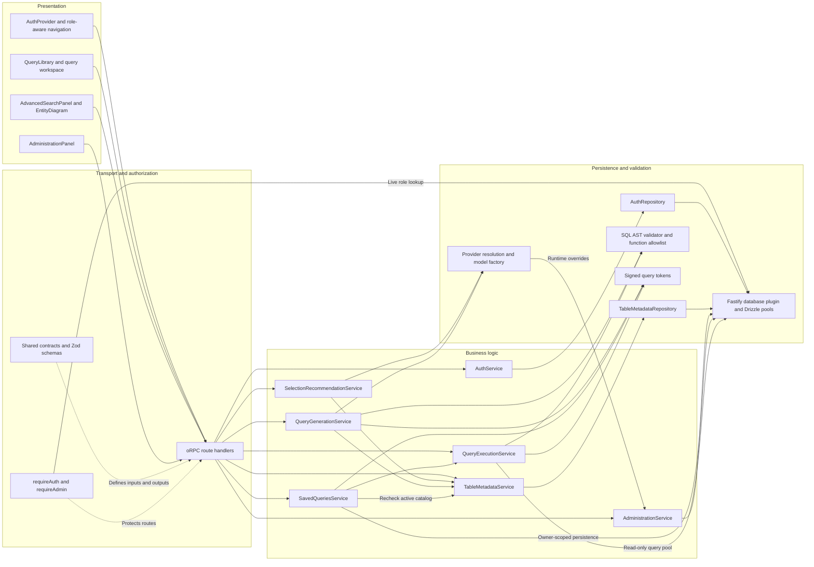

# Architecture Diagram

AI Advance Search is a contract-first TypeScript monorepo with a Next.js frontend, Fastify API, and two PostgreSQL databases. This document describes the implemented application, not a proposed deployment architecture.

## Application Architecture

<!-- mermaid-checked: no \n, no em-dash/en-dash, no {} in labels, subgraphs are id["label"], arrows are -->|"label"|, all subgraphs closed by end, ids unique -->

### Technology Stack Summary

| Layer | Technology | Version | Purpose |
| --- | --- | --- | --- |
| Runtime | Node.js and pnpm | Node 22+, pnpm 10.18.0 | Monorepo execution and dependencies |
| Presentation | Next.js, React, Tailwind CSS | 16, 19, 4 | App Router pages and interactive tools |
| Client state | TanStack Query and Table | 5, 8 | Server-state cache and results table |
| API | Fastify and oRPC | 5, 1.15 | REST handlers, typed contracts, OpenAPI |
| Validation | Zod and pgsql-ast-parser | 4, 12 | Input/output validation and SQL AST checks |
| LLM integration | Vercel AI SDK | 7 | Structured output and provider adapters |
| Authentication | jose and bcryptjs | See package manifests | JWT signatures and password hashing |
| Persistence | Drizzle ORM and Postgres.js | 0.45, 3 | Typed queries, transactions, connection pools |
| Database | PostgreSQL with pgvector and pg_trgm | PostgreSQL 17 | App records, metadata, full-text index |
| Testing | Vitest and PostgreSQL integration tests | See package manifests | Contracts, authorization, persistence, execution |

### Data Storage & External Services

The application database stores users/roles, documents/chunks, search history, the synthetic lending portfolio, saved SQL, provider overrides, and curated prompts. A separate database stores entity and column metadata used for selection, relationships, and query validation.

The API opens three logical pools: an application connection, a metadata connection, and a restricted query connection to the application database. The last one uses `QUERY_DB_URL`; development can fall back to the app role when it is absent, while production configuration requires it.

Ollama runs separately from the application. Cloud integrations use server-side API keys or the AWS SDK credential chain. Admin configuration never returns credentials to the browser and does not accept arbitrary provider URLs. The Next proxy is optional: the current browser client uses `NEXT_PUBLIC_API_URL` directly, so CORS configuration remains relevant.

### Key Architectural Decisions

- Shared oRPC contracts are the API source of truth. Public DTOs are independent from Drizzle database records.
- LLM output remains untrusted. SQL runs only after validation and a user-bound draft-token check or a user-owned saved-query lookup. Saved runs also recheck active metadata.
- IT-Admin permissions are checked against the current database role on every admin request. Role assignment is SQL-only. Database provider settings override environment defaults on subsequent requests.

## Component Relationships

<!-- mermaid-checked: no \n, no em-dash/en-dash, no {} in labels, subgraphs are id["label"], arrows are -->|"label"|, all subgraphs closed by end, ids unique -->

### Component Inventory

Paths are relative to the repository root.

| Component | Layer | Type | Responsibility |
| --- | --- | --- | --- |
| `apps/web/src/components/search/query-library.tsx` | Presentation | Client component | Search, open, run, rename, duplicate, edit, delete saved queries |
| `apps/web/src/components/search/advanced-search-panel.tsx` | Presentation | Client component | Builder state, prompt selection, schema review, generation, saving |
| `apps/web/src/components/search/entity-diagram.tsx` | Presentation | Client component | Entity relationships and draggable column selection |
| `apps/web/src/components/admin/administration-panel.tsx` | Presentation | Client component | Provider settings and curated prompt management |
| `packages/shared/src/contract/` | Transport | oRPC contracts | REST surface, input/output types, declared errors |
| `apps/api/src/orpc/base.ts` | Authorization | Middleware | Authentication boundary and current IT-Admin role checks |
| `apps/api/src/modules/auth/` | Business/persistence | Service and repository | Registration, password verification, JWTs, user data |
| `apps/api/src/modules/metadata/` | Business/persistence | Service and repository | Active tables, columns, friendly names, relationships |
| `apps/api/src/modules/administration/` | Business/persistence | Service | Provider overrides, runtime allowlists, published/admin prompt lists |
| `apps/api/src/modules/llm/` | Business/infrastructure | Services and helpers | Recommendations, generation, fallback, tokens, validation, execution |
| `apps/api/src/modules/saved-queries/` | Business/persistence | Service | Owner isolation, durable SQL, metadata checks before reruns |
| `apps/api/src/plugins/db.ts` | Infrastructure | Fastify plugin | Pool construction, app decoration, graceful shutdown |
| `packages/db/src/client.ts` | Infrastructure | Connection factories | Drizzle clients backed by Postgres.js |
| `packages/db/src/query-role.ts` | Operations | Provisioning script | Dedicated query role and lending-table grants |
| `packages/db/drizzle/` | Persistence | Migrations and snapshots | Versioned schemas, roles column, initial curated prompts |

## Boundaries and Current Limits

- The query role is provisioned by a separate script, not automatically by application startup or migrations.
- AST validation, a read-only transaction, timeout, row cap, and least-privilege grants are complementary safeguards, not a general-purpose SQL sandbox.
- Metadata is not a per-user data authorization policy. Add row-level security or tenant scoping before a multi-tenant deployment.
- Access JWTs are one hour; generated-query tokens are ten minutes. Admin role revocation is immediate at the API boundary, but general session revocation/refresh tokens are not implemented.
- Vector columns and indexes exist, but the document search repository currently implements lexical full-text search, not hybrid vector retrieval.
- Both Drizzle configs share schema exports and the migration directory. Inspect both database migration histories when changing the schema.
- No production deployment, CI workflow, queue, indexing worker, or centralized secret store is assumed by this diagram.