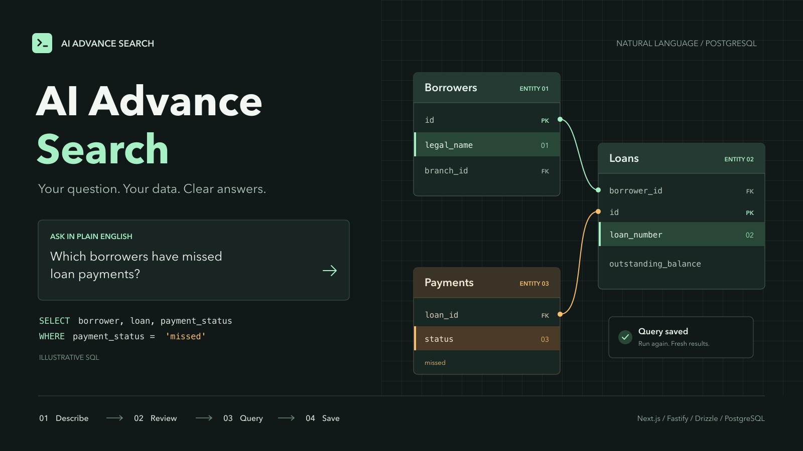
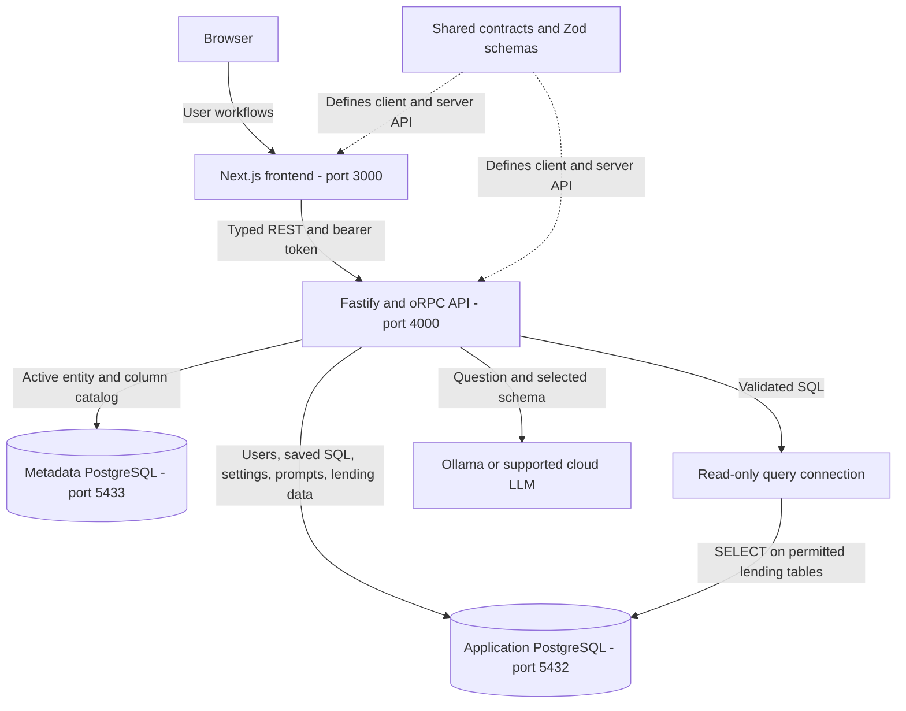

# AI Advance Search



A contract-first TypeScript monorepo for searching documents and turning plain-English questions into reviewable, read-only PostgreSQL queries.

The Next.js frontend shares an oRPC contract and Zod schemas with the Fastify API. Drizzle owns persistence across separate application and metadata databases. Generated SQL executes through a dedicated, restricted database connection.

## Features

- **Advanced DB Search:** describe a question, ask the LLM to recommend entities, columns, and typed filters, review the entity diagram, arrange output columns, and generate SQL before running it.
- **Query Library:** privately save generated SQL, search saved queries, run them repeatedly without an LLM call, rename, duplicate, edit, or delete them.
- **Curated Prompt Library:** choose an editable question from published, categorized prompts. Nine lending examples are included.
- **Provider and model selection:** choose from server-allowed Ollama, OpenAI, Anthropic, and Amazon Bedrock models. Ollama uses schema-constrained structured output.
- **IT-Admin section:** configure provider models, fallbacks, enabled/default status, Bedrock region/profile, and prompt publication/order. Roles are assigned through SQL only.
- **Document search:** PostgreSQL full-text search, pagination, highlighted snippets, and document CRUD. The navigation calls this **PG Vector Search**, but vector retrieval and embedding generation are not yet wired.

## Architecture

<!-- mermaid-checked: no \n, no em-dash/en-dash, no {} in labels, subgraphs are id["label"], arrows are -->|"label"|, all subgraphs closed by end, ids unique -->


See the [detailed architecture and component relationships](.github/modernize/assessment/engines/facts/architecture-diagram.md) for the connection boundaries, execution flow, and implementation inventory.

## Stack

| Layer | Technology |
| --- | --- |
| Runtime | Node.js 22+, pnpm 10.18.0, TypeScript |
| Web | Next.js 16 App Router, React 19, Tailwind CSS 4, Lucide icons |
| Client state and results | TanStack Query and TanStack Table |
| API | Fastify 5, oRPC REST/OpenAPI, Zod 4 |
| LLMs | Vercel AI SDK; Ollama, OpenAI, Anthropic, Amazon Bedrock |
| Persistence | Drizzle ORM, Drizzle Kit, Postgres.js |
| Database | PostgreSQL 17, pgvector, pg_trgm, Docker Compose |
| Authentication | bcrypt password hashing and signed JWT access tokens |
| Validation | Vitest, TypeScript, PostgreSQL-backed API integration tests |

## Repository Layout

```text
apps/
  api/
    src/
      config/             Environment and provider defaults
      modules/            Auth, metadata, LLM, saved queries, administration
      orpc/               API context, auth/admin middleware, OpenAPI
      plugins/            Database pools and REST adapter
      router/             Contract-bound request handlers
    tests/                Contract and opt-in database integration tests
  web/
    src/app/              Search, query builder/library, auth, admin pages
    src/components/       Entity diagram, results, dialogs, admin forms
    src/providers/        Authentication and query cache
packages/
  shared/src/             API contracts, Zod schemas, inferred types
  db/
    src/schema/           SQL schemas, including administration and saved SQL
    src/                  Connection factories, demo seeds, query-role setup
    drizzle/              Committed migrations and snapshots
    docker/               PostgreSQL extension initialization
  config/                 Shared TypeScript presets
scripts/platform.sh       Local process lifecycle and health checks
```

Workspace packages export TypeScript source: Next transpiles `@ais/shared`, and tsup bundles the API's workspace dependencies.

## Quickstart

Prerequisites: Node.js 22 or newer, pnpm 10.18.0, and a running Docker daemon. An LLM is needed for recommendations and SQL generation, but not to run previously saved queries.

```sh
cp .env.example .env
pnpm install --frozen-lockfile
docker compose up -d --wait
pnpm db:migrate
pnpm db:migrate:metadata
pnpm db:seed
pnpm db:query-role
pnpm platform:start
pnpm platform:status
```

Edit the root `.env` before starting. The example database URLs match the local Compose setup. Use a strong `JWT_SECRET`; the checked-in value is only a placeholder. Never use the local sample database passwords outside development.

| URL | Purpose |
| --- | --- |
| http://localhost:3000 | Home and live API status |
| http://localhost:3000/register | Create an ordinary user account |
| http://localhost:3000/search | Document full-text search |
| http://localhost:3000/advanced-search | Query Library and Builder |
| http://localhost:3000/admin | IT-Admin provider and prompt configuration |
| http://localhost:4000/docs | Interactive API reference |
| http://localhost:4000/openapi.json | Generated OpenAPI document |

The seed creates synthetic lending data, metadata, and sample searchable documents. The seed user has no usable password by default; register an account through the UI. Seeding lending metadata replaces matching catalog rows, so do not use it as a production data-loading command.

### Local LLM

Install and start Ollama separately, then pull a chat model, for example:

```sh
ollama pull llama3.2:latest
```

Set `LLM_PROVIDER=ollama` and `OLLAMA_MODEL=llama3.2:latest` in `.env`, then restart the API. Smaller models are faster but may fail SQL validation on complex joins. The built-in Ollama primary model is `qwen2.5-coder:32b`; pull that model if you keep the default. The built-in fallback is `llama3.1:latest`.

## Configuration

See [.env.example](.env.example) for the complete environment template. `.env` is local and must not be committed.

| Variable | Purpose |
| --- | --- |
| `APP_DB_URL` | Application data and authentication connection |
| `METADATA_DB_URL` | Entity and column metadata connection |
| `QUERY_DB_URL` | Dedicated generated-query role; required in production |
| `JWT_SECRET` | Stable JWT signing secret, at least 32 characters |
| `NEXT_PUBLIC_API_URL` | Browser-visible API origin and prefix |
| `API_URL` | Server-side destination for the optional Next proxy |
| `CORS_ORIGINS` | Comma-separated allowed browser origins |
| `LLM_PROVIDER` | Default provider before database overrides |
| `LLM_MODEL`, `LLM_FALLBACK_MODEL` | Model defaults for `LLM_PROVIDER` only |
| `LLM_TIMEOUT_MS` | Per-model generation timeout, default 120 seconds |
| `LLM_BASE_URL` | Server-managed Ollama OpenAI-compatible URL |
| `OLLAMA_MODEL`, `OPENAI_MODEL`, `ANTHROPIC_MODEL` | Per-provider primary models |
| `OLLAMA_FALLBACK_MODEL`, `OPENAI_FALLBACK_MODEL`, `ANTHROPIC_FALLBACK_MODEL` | Per-provider fallbacks |
| `OLLAMA_MODELS`, `OPENAI_MODELS`, `ANTHROPIC_MODELS`, `BEDROCK_MODELS` | Additional comma-separated model allowlists |
| `OPENAI_API_KEY`, `ANTHROPIC_API_KEY` | Server-side cloud credentials |
| `AWS_REGION`, `AWS_PROFILE` | Bedrock region and AWS credential profile |
| `LLM_AWS_REGION` | Optional region override |
| `BEDROCK_INFERENCE_PROFILE_ID`, `BEDROCK_MODEL_ID` | Bedrock model selection; inference profile takes precedence |

The API loads the root `.env` and optional app-local overrides. Next loads the root environment in its config. Run workspace commands through pnpm so each package uses the expected working directory.

### Provider Overrides

Admin-saved settings override environment-derived models, labels, enabled/default status, and allowlists on subsequent API requests. Default and fallback models are always included in the allowed models. Reload an already-open UI to refresh its cached choices.

The admin page supports the four implemented providers. It does **not** accept arbitrary endpoints or store API keys. Credentials and the Ollama endpoint stay server-managed. Bedrock uses the AWS SDK credential chain, including SSO; configuring a region/profile is not a test of AWS permissions or model access.

For AWS SSO:

```sh
aws sso login --profile YOUR_PROFILE
aws sts get-caller-identity --profile YOUR_PROFILE
```

Ensure the profile can access the inference profile and underlying models in the configured region. An expired SSO session can cause generation to fail even while the API is healthy.

## User Workflows

### Build and Save a Query

1. Sign in and open **Advanced DB Search**. The default screen is the Query Library.
2. Choose **New query**. Type a question or select an editable curated prompt.
3. Choose **Suggest selection**, or select tables manually. Primary keys are initially selected. Review relationships and arrange output columns in the diagram/output list.
4. Review **Filter parameters** above Generate SQL. Recommendations use the prompt and active column metadata. Add/remove conditions, choose operators, and edit values; confirm **Use no filters** if no conditions are needed.
5. Choose **Generate SQL**, inspect the draft, then **Run query** or **Save query**.
6. In the Library, open a saved query, adjust its **Run parameters**, and run it without another LLM request. Its SQL is revalidated against current active metadata on each run.

The action menu supports rename, duplicate, edit, and confirmed deletion. Editing offers **Save changes** for the original query or **Save a copy**. Saved queries are private to their owner.

### Reusable Filter Parameters

Filter controls derive from column metadata: numeric inputs respect precision/scale, integers respect their database range, dates/timestamps use date controls, booleans use Yes/No, enum columns use their `allowed_values`, and text/UUID fields are validated. Column descriptions appear beside the controls. Metadata seeding reads enum choices from PostgreSQL; migrations backfill the existing public enum catalog without reseeding rows.

Saving stores both filter definitions and the current default values. Saved-query runs accept value overrides only, not SQL or replacement filter definitions. Overrides do not change stored defaults; **Reset defaults** restores them. To persist different defaults, edit the query and save changes. Changing a value does not require another LLM call, while adding/removing a condition or changing an operator requires SQL regeneration.

Managed filters combine with **AND** and currently support direct SELECT/JOIN queries, not CTEs or UNION queries. The model generates the unfiltered query structure; the server adds filter predicates through the SQL AST and binds values as Drizzle parameters. Unsupported or invalid SQL is rejected rather than executed. Existing saved queries without filters continue to run as before.

### Assign an Administrator

New users always receive the `User` role. There is no role-management UI or public role-assignment endpoint. Run this against the **application database** using an authorized database account:

```sql
UPDATE users
SET role = 'IT-Admin'
WHERE email = 'your-email@example.com';
```

Reload the browser or sign in again to display the Admin link. Every admin API request checks the current role in Postgres, so demotion to `User` revokes admin API access immediately, even with an existing JWT.

Administrators can publish/unpublish, categorize, order, edit, and delete prompts. Only published prompts appear in the Builder. Choosing or editing a prompt does not itself call the LLM.

## SQL Execution Safeguards

- The browser submits a user-bound signed draft token, not arbitrary SQL. Draft tokens expire after ten minutes; saved SQL is persisted separately and can be run later.
- `pgsql-ast-parser` validates a single read-only statement, table and column references, unique output names, and allowed function calls. `count(*)` is allowed; wildcard column selection is blocked.
- Validated SQL structure runs through Drizzle in a read-only transaction, with a five-second statement timeout and a 200-row response cap. Editable filter values are bound separately as SQL parameters; they are never inserted into raw SQL text.
- `pnpm db:query-role` provisions the role in `QUERY_DB_URL` with `SELECT` access to the supported lending tables. Re-run it after changing the queryable table allowlist.
- Production requires `QUERY_DB_URL`. Development currently falls back to the application role, with a warning, if it is absent; do not rely on that fallback for untrusted queries.
- Provider output is untrusted. JSON-schema-constrained output helps parsing; it does not guarantee correct or safe SQL. Validation can reject a model response.

These checks are defense in depth, not a complete SQL sandbox or tenant-authorization system. Review database privileges, row-level security, function/extension access, network access, and data sensitivity before deployment. Schema metadata and user questions are sent to the selected LLM provider. The LLM generation flow does not receive query results.

## API Overview

REST endpoints are mounted under `/api/v1`; full request/response schemas and errors are available in `/docs`.

| Group | Routes |
| --- | --- |
| Authentication | `POST /auth/register`, `POST /auth/login`, `GET /auth/me` |
| Health | `GET /health`, `GET /ready` |
| Documents | `GET /documents`, `GET /documents/{id}`, `POST /documents`, `DELETE /documents/{id}` |
| Document search | `GET /search` |
| Catalog | `GET /metadata/schema`, `GET /prompts` |
| LLM | `GET /llm/providers`, `POST /llm/recommend-selection`, `POST /llm/generate-query`, `POST /llm/execute-query` |
| Saved queries | `GET /saved-queries`, `POST /saved-queries`, `PATCH /saved-queries/{id}`, `POST /saved-queries/{id}/run`, `POST /saved-queries/{id}/copy`, `DELETE /saved-queries/{id}` |
| Administration | `GET /admin/providers`, `PUT /admin/providers`, `GET /admin/prompts`, `PUT /admin/prompts`, `DELETE /admin/prompts/{id}` |

Use `Authorization: Bearer <accessToken>` for protected endpoints. Access tokens last one hour. Missing or invalid authentication returns 401; admin requests from non-admin users return 403. Health endpoints and account registration/login are public.

## Development and Verification

```sh
pnpm typecheck
pnpm test
NODE_ENV=production pnpm build
```

Use the explicit production environment when building: an exported `NODE_ENV=development` or `NODE_ENV=test` can interfere with Next.js prerendering. This command does not change your local `.env`.

The default test command runs unit/contract tests and skips opt-in database suites. Start and migrate both local databases, seed the demo data, and configure the read-only role before running:

```sh
LOG_LEVEL=silent RUN_DB_INTEGRATION_TESTS=true pnpm --filter @ais/api test
```

Database integration tests create and clean up temporary users/rows. The administration suite temporarily changes Ollama settings and restores them; use a disposable local database, not production. These tests do not require paid LLM calls. Browser checks for live model quality are separate.

| Command | Purpose |
| --- | --- |
| `pnpm dev`, `pnpm dev:api`, `pnpm dev:web` | Foreground development servers |
| `pnpm platform:start`, `pnpm platform:stop`, `pnpm platform:status` | Managed local services; logs/PIDs under ignored `.platform/` |
| `pnpm build`, `pnpm start` | Build and start production app bundles |
| `pnpm db:up`, `pnpm db:down` | Start/stop Compose databases |
| `pnpm db:generate` | Generate a migration from Drizzle schemas |
| `pnpm db:migrate`, `pnpm db:migrate:metadata` | Migrate each database |
| `pnpm db:seed` | Load synthetic demo data and metadata |
| `pnpm db:query-role` | Provision/update the restricted SQL execution role |
| `pnpm db:studio`, `pnpm db:push` | Local schema tooling; push bypasses migrations |

Both migration configs currently use the same schema exports and migration directory. They are not independent migration histories by domain; inspect changes carefully and apply the expected migrations to each database. Commit SQL migrations, snapshots, and the migration journal together.

To add an endpoint, update the shared oRPC contract, implement its handler, and use the typed web client. To change persistence, update the Drizzle schema, generate/review a migration, and apply it. CI, lint/format tooling, rate limiting, refresh-token/session revocation, and an embedding/indexing worker are not included.

## Git Publishing Checklist

1. Keep `.env`, credentials, local AWS files, logs, `.platform/`, `node_modules/`, and build outputs out of Git. `.env.example` contains placeholders only; replace its development credentials when deploying.
2. Review the actual staged file list and scan staged contents for credentials before committing. Ignoring a file does not untrack it if it was already committed.
3. Run the typechecks, default tests, database integration tests, and explicit production build above.
4. Commit source, migrations/snapshots, documentation, package manifests, and `pnpm-lock.yaml` together.
5. Configure the intended Git remote and push only after confirming repository visibility and access permissions.

This directory must be initialized as a Git repository or placed in the intended existing checkout before Git status, staging, commit, and push commands can be used. No repository URL, license, branch policy, or credentials are assumed by this project.